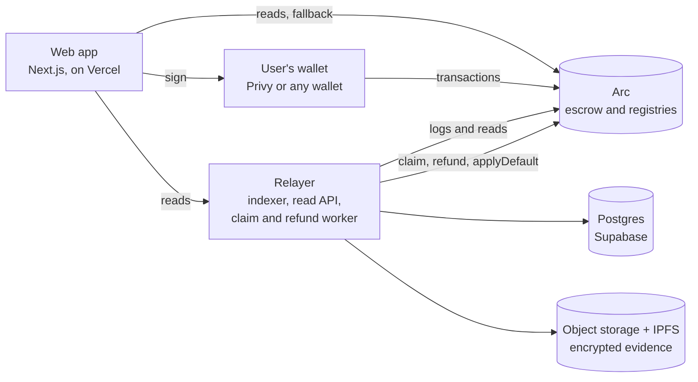

# Architecture

Waybill has one source of truth for money and state, the contracts on Arc, and a thin offchain layer that reads from them. The offchain layer cannot move deal money.

## Contracts

See [Contracts](contracts.md). The escrow holds all deal USDC; the arbiter list, attestor registry and the two vaults are separate contracts with no path to that money. Everything a user does that changes a deal is a transaction their own wallet signs.

## Relayer (`services/relayer`)

One long-running process (TypeScript, run directly by Bun) that does five jobs:

1. **Indexes** every escrow, registry and arbiter-list event into Postgres, in four loops with their own cursors (`escrow-indexer`, `escrow-relayer`, `registry-indexer`, `arbiter-indexer`). It starts at the escrow's deploy block and reads logs in bounded ranges, so a restart resumes where it stopped.
2. **Serves a read API** (see [API](api.md)): deals, events, wallets, arbiters, attestors, the operator summary, and a cached read-only JSON-RPC front so many visitors share one upstream RPC.
3. **Sends the routine transactions.** When the chain shows a part is payable, refundable or past its deadline, it checks the part's state again on chain and sends `claim`, `refund` or `applyDefault` from a gas-only wallet. These functions are open to everyone, so the relayer has no special power: if it stops, anyone can send them. Each attempt is recorded so it is not sent twice, and nonces are serialised, so exactly one relayer instance runs.
4. **Stores evidence and terms** and sends **email** updates, both optional.
5. **Raises operator alerts**: every pauser action, every failed payout or refund, low relayer gas, indexer lag and money held near the total cap. See [Operations](../operations.md#alerts).

On start it checks that its RPC serves the chain id the network manifest names, and it refuses to start on mainnet without an alert destination.

## Web app (`apps/web`)

Next.js. Public pages (home, the public record, the supplier link, attestor directory) are rendered on the server and ship no wallet code. The signed-in app (`/app`) loads Privy and wagmi. The supplier page loads the wallet code only when the supplier chooses to sign in.

All values shown come from the chain or the relayer; nothing is hard-coded or invented. Chain reads fall back to the public RPC if the relayer's read front is unreachable. The timeline and the wallet lists need the relayer, and the app says when they are unavailable instead of showing nothing.

## Network manifest (`packages/network`)

One file, `packages/network/src/networks.ts`, holds the chain id, RPC and explorer URLs, USDC address, every contract address, Multicall3 and the deploy blocks for each network. The relayer and the web app both read it. Mainnet resolves only from the checked-in manifest: environment variables may repeat a value but never change it, and any mismatch stops the process. Only the RPC URL can be replaced, so a dedicated keyed RPC can be used. A build refuses the local-fork override on a hosted platform.

## Data flow for a payment

1. The buyer's wallet sends `fund`. The escrow emits `DealFunded`.
2. The relayer indexes it. For an acceptance part, the escrow already put the part in review.
3. When the review window ends, the relayer reads the part, sees it is eligible, and sends `claim`.
4. The escrow checks the state itself, pays the supplier's payout wallet, and emits `TrancheClaimed`.
5. The relayer indexes that, the app updates, and the record page shows it with a link to the transaction.

If the relayer is down at step 3, the app offers the same `claim` to the parties.

## Where things live

| What | Where | Authoritative? |
|---|---|---|
| Money, deal and part state, timers, attestation checks, fees | Escrow contract | Yes |
| Events and the timeline | Postgres index (`waybill_chain_events`) | No: rebuilt from the chain |
| Deal summaries, wallet lists, directories | Postgres projections | No: the app shows live chain reads, and marks cached data as stale |
| Evidence files | Encrypted in object storage and on IPFS | The chain holds the commitment |
| Deal terms (goods, names), emails | Postgres | Yes, offchain only |

See [Data model](data-model.md).
